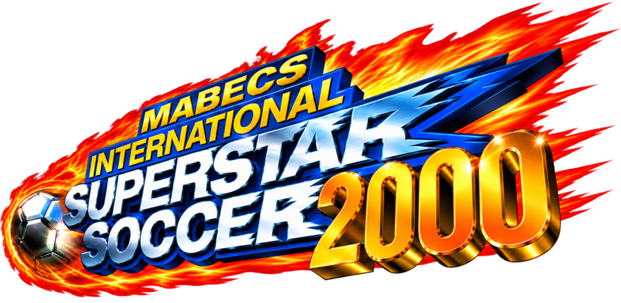
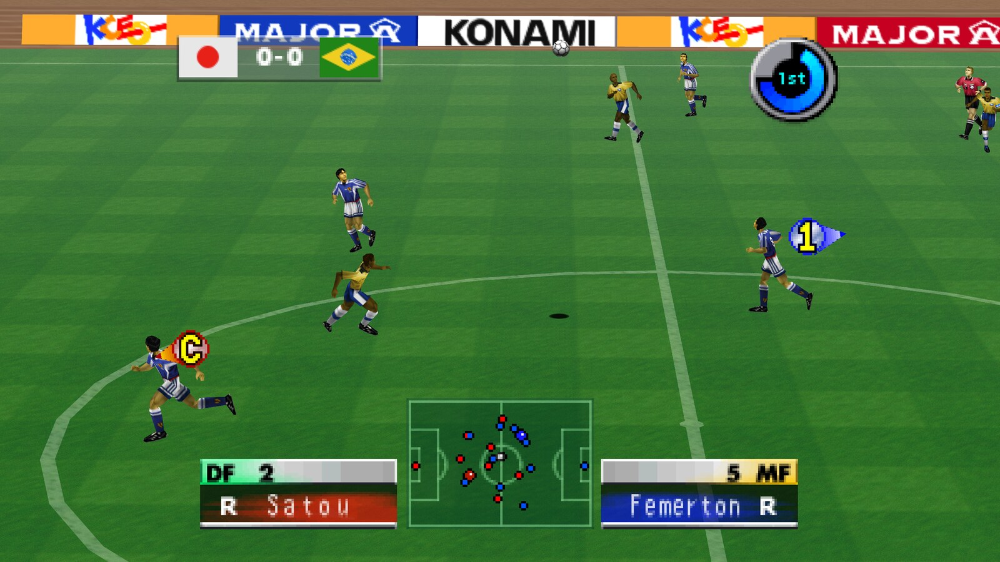
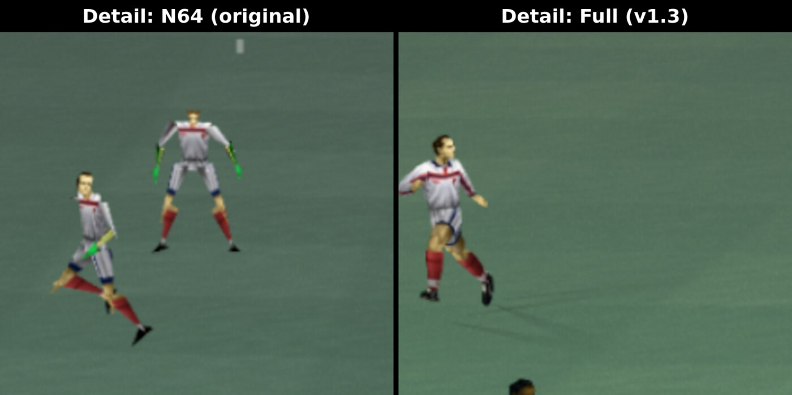
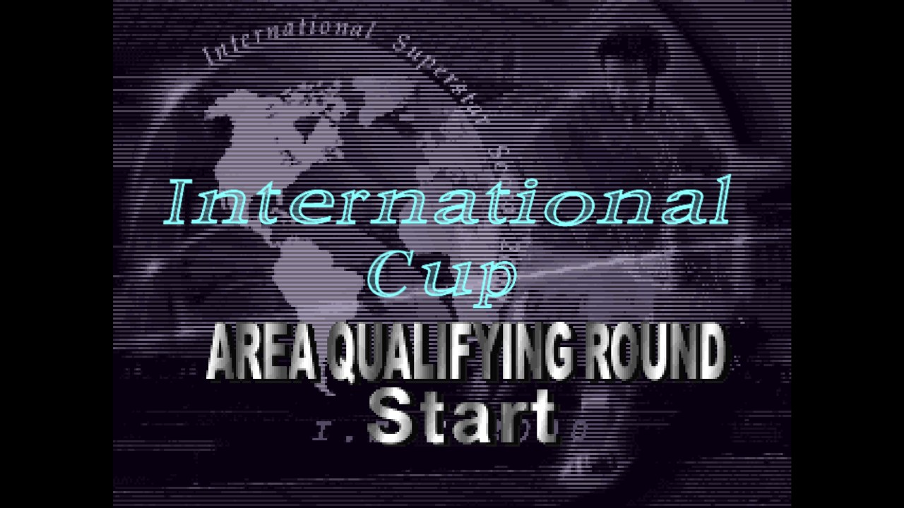

# Mabecs International Superstar Soccer 2000 - Widescreen build

**A true widescreen version of the Nintendo 64 classic.** The original game was made for 4:3 TVs; this build renders
the full 16:9 (or wider) view at your screen's resolution. Players and the ball stay visible all the way to the edges
of the screen, and the stadium sky fills the whole width instead of leaving black bars.

 
<em>A match in native 16:9 widescreen at 2560x1440 with full-detail players (v1.3), with the original HUD.</em>

Native Linux and Windows port of **International Superstar Soccer 2000** (Nintendo 64: USA Rev 1 and both European versions) made by static
recompilation with [N64Recomp](https://github.com/N64Recomp/N64Recomp), running on
[N64ModernRuntime](https://github.com/N64Recomp/N64ModernRuntime) with the [RT64](https://github.com/rt64/rt64)
renderer.

**No game data is included.** You need your own ROM. One build (AppImage or Windows zip) supports all three versions;
the launcher detects which one you give it:

| ROM | SHA-1 |
|---|---|
| `International Superstar Soccer 2000 (USA) (En,Es) (Rev 1)` | `47a993fe1316dfd9e208603370d3dddae05f1d1b` |
| `International Superstar Soccer 2000 (Europe) (En,De)` | `e7078e5f1e899382b1cc145df43ee8cfaa924297` (as .z64) |
| `International Superstar Soccer 2000 (Europe) (Fr,It)` | `b0505e13ba0f029ea735378c50b224fd618be302` |

`.z64`, `.n64` and `.v64` byte orders are all accepted. The European versions have their own languages (set under
Option > Language) and a harder single-player game.

## New in v1.4: Online 1 vs 1
Play a match against a friend over the internet or your local network, each on their own computer.
- **Click Online in the launcher, then Host or Join.** The host gets a short, soccer-themed pass phrase such as
  `EU-STRIKER-VOLLEY-HEADER-GOAL` (copy it with one click) and sends it to their friend. The friend pastes it in
  Join and the match starts on both machines. No port forwarding or IP addresses needed.
- **Finds the fastest route automatically.** Connections are set up through UDP hole punching, and if both players
  are on the same network they find each other directly on the LAN.
- **Both games stay in sync.** Controller input is exchanged in lockstep with a small input delay and redundant
  packets, so dropped packets are recovered without a hitch. The game's random events (decisions, bounces, AI)
  play out identically on both machines, and each side checks this continuously.
- **Online Controller Pak**: online matches have their own pak (`controllerpak_online_p1.mpk`, separate from your
  normal saves), so you can save your progress together. It stays identical on both machines as long as you keep
  playing online with the same friend.
- **Smooth audio online**: a deeper audio buffer keeps sound clean through small network hiccups.
- The host is player 1, the joining player is player 2. Both players need the same game version (USA, Europe
  En,De or Fr,It) and v1.4 or later. If the connection drops for 5 seconds, both games return to the launcher.
- You can also join by typing the host's IP address instead of the pass phrase (port 9099 by default).

See [online.md](online.md) for how it works and command-line options.

## New in v1.3: full-detail players
On the N64, players further from the camera were drawn with simpler, lower-polygon models (a level-of-detail
filter that saved memory and rendering time): blocky bodies, no hands, flat heads. In a match even the nearest
players never got the game's best model, which was kept for close-ups.
v1.3 removes that filter: **every player always uses the best, most detailed model**, at any distance.
- New launcher option **Detail: Full / N64**. Full (default) is the high-detail models; N64 restores the original
  behaviour.
- Works in all three versions (USA, Europe En,De and Fr,It). Only the models change; gameplay is the same.

 
<em>Players far from the camera: the original low-detail models (left) and the full-detail models in v1.3 (right).</em>

## New in v1.2: European versions
v1.2 adds support for both European (PAL) releases of the game, in the same AppImage as the USA version:
- **Europe (En,De)**: English and German. **Europe (Fr,It)**: French and Italian (menus, messages and commentary).
  The language is set in the game under Option > Language.
- **European-only content**: the **International Cup** tournament mode, and a harder single-player game.
- Same widescreen, sky and culling fixes as the USA version.
- Runs at 50 Hz like on a PAL console; speed, match clock and audio are what the European game was made for.
- The launcher detects which ROM you give it; with several ROMs stored, the button next to "Change ROM..." switches
  between versions. Controller Pak saves are kept separate per version.

 
<em>The International Cup, only in the European versions.</em>

## Features
- **Widescreen**: 16:9 and wider, with the game's culling widened (no player pop-in at the edges) and the stadium sky
  extended to the full width; HUD stays in its original layout
- **Full-detail players** at any distance (no N64 level-of-detail models; launcher option)
- Window-scaled resolution, 4x MSAA
- **Online 1 vs 1** over the internet or LAN, with pass-phrase matchmaking
- Controller Pak saves (raw 32 KB `.mpk`, Project64-compatible), kept separately per version
- Launcher: ROM selection (file picker or drag & drop), version choice when several ROMs are stored,
  Fullscreen/Widescreen/Detail options
- Gamepad and keyboard input

## Download
Get it from [Releases](../../releases).
- **Linux**: the AppImage. Runs on Debian 12+, Ubuntu 22.04+ and newer distros (glibc 2.34+, Vulkan GPU).
  Data is stored in `~/.local/share/iss2000recomp`.
- **Windows**: the zip. Extract it anywhere and run `ISS2000Recompiled.exe` (keep the DLLs next to it).
  Windows 10/11 64-bit with a Direct3D 12 or Vulkan GPU. Data is stored in `%APPDATA%\iss2000recomp`.

## Controls
Gamepad or keyboard (arrows/WASD stick, X = A, C = B, Z = Z, Enter = Start, Q/E = L/R, IJKL = C buttons).
**F11** toggles fullscreen, **Esc** quits.

## Notes
- The European versions run at 50 Hz like on a PAL console (matches at 25 fps instead of 30). Their game speed, match
  clock and audio are tuned for that, so they play at the intended speed; they can't run at 60 Hz.
- The in-game Resolution option always runs in the normal mode: RT64 already renders at your screen's
  resolution, and the N64's 640x480 High mode broke speed/widescreen when switched mid-game.

## Known issues
- **v1.0 only:** the in-game Resolution: High option works as intended in windowed mode only. In fullscreen on
  high-refresh-rate monitors (e.g. 144/240 Hz) it can make the game run at double speed. If you play fullscreen on
  v1.0, set Resolution to Low in the game's options (v1.1 and later do this automatically).
- No rumble; no controller remapping yet.
- Online: pass-phrase matchmaking needs both networks to allow UDP hole punching (most home routers do); there
  is no relay fallback for very strict NATs, so use direct IP with port forwarding in that case. During online
  matches player detail is always Full on both sides.

## Building
See [NOTES.md](NOTES.md) for the full pipeline (overlay discovery, symbol generation, recompilation, hooks,
Debian 12 portable build, AppImage packaging). Third-party sources go in `ext/` (N64Recomp, N64ModernRuntime,
RT64; see NOTES.md); apply `patches/N64ModernRuntime-vi-rate.patch` (50 Hz support for the European versions) and
then `patches/N64ModernRuntime-netplay.patch` (online VI pacing, restart after a match) to N64ModernRuntime. Generated code is produced locally from your ROMs and is not part of this repository.

Windows: with Visual Studio 2022 (Build Tools: "Desktop development with C++" + "C++ Clang tools for Windows") and
Python 3, run `tools\build_windows.bat` (clang-cl + Ninja, output in `build-win\`), then
`powershell -ExecutionPolicy Bypass -File tools\make_windows_zip.ps1` for the release zip in `dist\`.

## License
GPL-3.0 (see `LICENSE`), as the program includes N64ModernRuntime and code adapted from Zelda64Recomp.
International Superstar Soccer is a trademark of Konami. Not affiliated with Konami or Nintendo.
